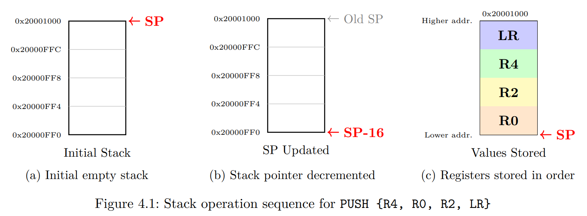

# Procedures and the Stack

## Learning Objectives

After completing this experiment, you will be able to:

* Call and return from procedures using `BL` and `BX LR`.
* Apply the ARM Procedure Call Standard (AAPCS) to pass parameters, return results, and decide which registers must be preserved.
* Use `PUSH` and `POP` to save and restore callee-saved registers and `LR` on the full descending stack.
* Implement nested and recursive procedures that manage the stack correctly.

## Experiment Overview

This experiment builds on the branching and loop patterns from Experiment 3 to write modular assembly code. You will define procedures, follow the AAPCS calling convention for arguments, return values, and register preservation, and use the stack to save the return address and working registers across nested and recursive calls. By the end of this lab, you will be able to split a program into reusable procedures that call each other safely.

---

## Theoretical Background

### ARM Architecture Procedure Call Standard (AAPCS)

Procedures are reusable blocks of code that encapsulate a specific task. They promote modular design, code reuse, and clearer program structure. In ARM assembly, procedures are implemented using branch-and-link instructions along with register usage conventions defined by the ARM Architecture Procedure Call Standard (AAPCS).

A `procedure` (also called a subroutine, function, or method in high-level languages like C, C++, or Java) is a self-contained block of assembly code designed to perform a specific task.

The AAPCS is the set of rules that define how functions exchange data and how registers must be preserved during a procedure call:

* **R0–R3**: Hold the first four parameters. R0 also holds the return value. Caller-saved.
* **Stack**: Any additional parameters beyond the first four are passed on the stack.
* **R4–R11**: Must be preserved by the callee. If a procedure uses them, it must save and restore them.
* **R12 (IP)**: Intra-procedure-call scratch register. Caller-saved — a callee may freely overwrite it, so (like R0–R3) never assume it survives a BL.
* **SP (R13)**: Stack pointer, always points to the current top of the stack.
* **LR (R14)**: Link register holds the return address. Caller-saved.

*Note: Callees are the procedures being called, while callers are the ones calling the procedure.*

In accordance with your template guidelines, here is Section 4.1.2 converted directly to Markdown, with the code snippet expanded into a full, ready-to-run Keil ARM Cortex-M4 assembly program:

# Procedure Templates

A procedure is entered with a `BL` (branch-with-link) instruction, which stores the return address in the link register `LR`. The callee returns by branching to `LR` (e.g., `BX LR`). By the AAPCS, the first four arguments are passed in `R0`–`R3` and the primary return value is placed in `R0`.

## Basic Procedure Template

**Example:** simple procedure that expects two integers in `R0` and `R1` and returns their sum in `R0`.

```assembly
; PCB Used: EK-TM4C123GXL
; MCU Used: TM4C123GH6PM
; MPU Used: ARM Cortex M4F - ARMv7-M
        AREA    RESET, CODE, READONLY
        EXPORT  __Vectors
__Vectors
        DCD     0x20001000            ; Initial SP (example top-of-stack)
        DCD     Reset_Handler          ; Reset vector

        AREA    MYCODE, CODE, READONLY
        ENTRY
        EXPORT  Reset_Handler

Reset_Handler
        ; Load example arguments into R0 and R1
        MOV     R0, #5                ; First parameter = 5
        MOV     R1, #10               ; Second parameter = 10

        ; Call procedure
        BL      AddTwo                ; R0 will hold return value (15 / 0x0F)

STOP    B       STOP

; Listing 4.1: Basic procedure structure
AddTwo  PROC
        ADD     R0, R0, R1            ; return R0+R1 in R0
        BX      LR
        ENDP

        END

```

*Note: The `PROC` and `ENDP` directives help define the start and end of a procedure and they could be safely omitted.*

---
## Procedure with Preserved Registers


When a procedure uses callee-saved registers (R4–R11), it must preserve their original values by saving them on the stack and restoring them before returning:

```assembly
; PCB Used: EK-TM4C123GXL
; MCU Used: TM4C123GH6PM
; MPU Used: ARM Cortex M4F - ARMv7-M
        AREA    RESET, CODE, READONLY
        EXPORT  __Vectors
__Vectors
        DCD     0x20001000            ; Initial SP (example top-of-stack)
        DCD     Reset_Handler          ; Reset vector

        AREA    MYCODE, CODE, READONLY
        ENTRY
        EXPORT  Reset_Handler

Reset_Handler
        ; Set up example parameters for ProcessArray
        LDR     R0, =SampleArray       ; Load address of array into R0 (1st parameter)
        MOV     R1, #5                 ; Pass array length into R1 (2nd parameter)

        ; Call procedure (AAPCS guarantees R4-R6 remain untouched after this call)
        BL      ProcessArray           ; Result stored in R0

STOP    B       STOP

; Listing 4.2: Procedure using preserved registers
ProcessArray PROC
        PUSH    {R4-R6, LR}            ; Save used registers and LR
        MOV     R4, R0                 ; Save array pointer
        MOV     R5, R1                 ; Save array length
        MOV     R6, #0                 ; Initialize counter

        ; Process array using R4, R5, R6...

        MOV     R0, R6                 ; Return counter value
        POP     {R4-R6, PC}            ; Restore registers and return
        ENDP

        AREA    MYDATA, DATA, READWRITE
SampleArray
        DCD     10, 20, 30, 40, 50

        END

```
Let's take this step-by-step and unpack **how a function uses registers**, **what the roles are**, and **what actually happens in memory**.

---

#### 1. The Cast of Characters (Register Roles)

Think of the ARM CPU registers like a workbench with 16 labeled slots (`R0` through `R15`). To prevent functions from stepping on each other's toes, engineers agreed on a set of ground rules called **AAPCS** (ARM Architecture Procedure Call Standard):

| Register | Rule Name | Role in Plain English |
| --- | --- | --- |
| **`R0` – `R3**` | **Scratchpad / Arguments** | Used to pass up to 4 inputs into a function. `R0` is also used to hand back the **final answer (return value)**. *Rule:* A called function can overwrite these freely without cleaning up. |
| **`R4` – `R11**` | **Callee-Saved (Protected)** | Used by functions for long-term variables. *Rule:* If a function wants to use any of these, **it must save their original values first and restore them before leaving**. |
| **`R13` (SP)** | **Stack Pointer** | Points to the current top of the stack (RAM memory used as temporary storage). |
| **`R14` (LR)** | **Link Register** | Holds the return address—the "bookmark" telling the CPU where to go back after finishing a function. |
| **`R15` (PC)** | **Program Counter** | Holds the address of the instruction being executed *right now*. |

---

#### 2. The Contractor & The Specialist

Imagine **Main Program** is a general contractor, and **`ProcessArray`** is a specialist sub-contractor.

1. **Main Program** puts tools/materials in boxes `R0` and `R1` (the inputs) and hands them to **`ProcessArray`**.
2. **`ProcessArray`** needs working drawers `R4`, `R5`, and `R6` to do its job.
3. But drawers `R4`–`R6` already contain Main Program's personal belongings!
4. So, before starting work, **`ProcessArray`** safely puts Main Program's belongings onto a storage shelf (**The Stack**).
5. **`ProcessArray`** uses drawers `R4`–`R6` for its own work.
6. When finished, **`ProcessArray`** puts Main Program's items back into drawers `R4`–`R6` and puts the return result into box `R0`.

---

#### 3. Step-by-Step Execution of the Code

Let's walk through this exact code line by line to see what happens to the registers.

```assembly
; MAIN PROGRAM (The Caller)
Reset_Handler
    MOV     R4, #99               ; Main Program puts 99 in R4 (important value!)
    LDR     R0, =SampleArray      ; Step 1: Pass array address in R0
    MOV     R1, #5                ; Step 2: Pass array length in R1
    BL      ProcessArray          ; Step 3: Call function! (Saves next address into LR)
    
    ; <-- We return here after the procedure finishes!
    ; At this point, R4 is STILL 99 (guaranteed by AAPCS!)
    ; R0 holds the return value.

```

Now let's step inside the function **`ProcessArray`**:

##### Step A: The Entry — Protecting the Caller's Data

```assembly
ProcessArray PROC
    PUSH    {R4-R6, LR}           ; Step 4

```

* **What happens:**
1. The CPU takes the current values inside `R4` (which is `99`), `R5`, `R6`, and `LR` (the bookmark to return home).
2. It pushes them onto **The Stack** (RAM memory).
3. Now `R4`, `R5`, and `R6` are safely backed up on the shelf!


---

##### Step B: The Work — Using the Registers

```assembly
    MOV     R4, R0                ; Step 5: Copy array address (R0) into R4
    MOV     R5, R1                ; Step 6: Copy length (R1) into R5
    MOV     R6, #0                ; Step 7: R6 = counter = 0

```

* **Why do this?**
* If `ProcessArray` called *another* function later, `R0` and `R1` might get overwritten.
* By copying `R0` into `R4` and `R1` into `R5`, `ProcessArray` guarantees its inputs are safe in `R4`–`R5` throughout its work.


---

##### Step C: Setting Up the Return Value

```assembly
    MOV     R0, R6                ; Step 8: Put result into R0

```

* **Rule:** By AAPCS standard, the result of any function **must** be placed in `R0` before returning.

---

##### Step D: The Exit — Restoring Everything and Returning

```assembly
    POP     {R4-R6, PC}           ; Step 9
    ENDP

```

* **This line does TWO major things at once:**
1. **Restores Registers:** It pulls the original values off the Stack and puts them back into `R4`, `R5`, and `R6`. Now `R4` is back to `99`!
2. **Returns Home:** It pulls the saved return address (originally `LR`) off the Stack and loads it directly into **`PC`** (Program Counter).


* Loading an address into `PC` causes the CPU to instantly jump to that address—returning right back to the line after `BL ProcessArray` in the main program!

---

### Nested Procedure Calls

When one procedure calls another, the link register (`LR`) must be preserved, otherwise the return address would be lost. This is done by pushing `LR` onto the stack before making another call.

```assembly
; PCB Used: EK-TM4C123GXL
; MCU Used: TM4C123GH6PM
; MPU Used: ARM Cortex M4F - ARMv7-M
        AREA    RESET, CODE, READONLY
        EXPORT  __Vectors
__Vectors
        DCD     0x20001000            ; Initial SP (example top-of-stack)
        DCD     Reset_Handler          ; Reset vector

        AREA    MYCODE, CODE, READONLY
        ENTRY
        EXPORT  Reset_Handler

Reset_Handler
        ; Call the outer procedure
        BL      OuterProc             ; R0 will hold 42 after returning

STOP    B       STOP

; Listing 4.3: Nested procedure example
OuterProc PROC
        PUSH    {LR}                  ; Save return address to main program
        BL      InnerProc             ; Call inner procedure (overwrites LR)
        MOV     R1, R0                ; Use return value (R1 = 42)
        POP     {PC}                  ; Return to caller (Restores original LR into PC)
        ENDP

InnerProc PROC
        MOV     R0, #42               ; Return value
        BX      LR                    ; Return to OuterProc
        ENDP

        END

```


## Stack Model (Full, Descending)

There are four common stack models based on two characteristics: whether the stack is full or empty, and whether it grows up (ascending) or down (descending).

* **Full Ascending:** SP points to the last used location; stack grows toward higher addresses.
* **Empty Ascending:** SP points to the next free location; stack grows toward higher addresses.
* **Empty Descending:** SP points to the next free location; stack grows toward lower addresses.
* **Full Descending:** SP points to the last used location; stack grows toward lower addresses.

The ARM Cortex-M4 uses a full descending stack, meaning:

* The stack pointer (`SP`) points to the last used location (full).
* The stack grows toward lower memory addresses (descending).

### Stack Operations

The Cortex-M4 provides `PUSH` and `POP` instructions that automatically update the stack pointer (`SP`) and allow saving or restoring multiple registers in a single instruction. These operations are essential for implementing procedure calls, local variables, and context switching.

#### PUSH

The `PUSH` instruction saves one or more registers onto the stack in a single operation. When executed, the stack pointer (`SP`) is decremented to reserve space, and the specified registers are written to consecutive memory locations starting from the new `SP` value.

**Rule:** `PUSH` stores registers on the stack, with the lowest-numbered register placed at the lowest memory address and the highest-numbered register placed at the highest memory address. This guarantees a consistent and predictable memory layout for saved contexts.

**Example:**

```assembly
; PCB Used: EK-TM4C123GXL
; MCU Used: TM4C123GH6PM
; MPU Used: ARM Cortex M4F - ARMv7-M
        AREA    RESET, CODE, READONLY
        EXPORT  __Vectors
__Vectors
        DCD     0x20001000            ; Initial SP (example top-of-stack)
        DCD     Reset_Handler          ; Reset vector

        AREA    MYCODE, CODE, READONLY
        ENTRY
        EXPORT  Reset_Handler

Reset_Handler
        ; Load sample values into registers
        MOV     R0, #0x11
        MOV     R2, #0x22
        MOV     R4, #0x44
        MOV     LR, #0x99

        ; Example: PUSH {R4, R0, R2, LR}
        ; Even if the list appears unordered, values are laid out by register number:
        ; R0 (lowest address), then R2, R4, and LR (highest address).
        ; Each register occupies 4 bytes, so SP decreases by 16 bytes in total.
        ; The program counter (PC) cannot be pushed by this instruction.
        PUSH    {R4, R0, R2, LR}

STOP    B       STOP
        END
```

